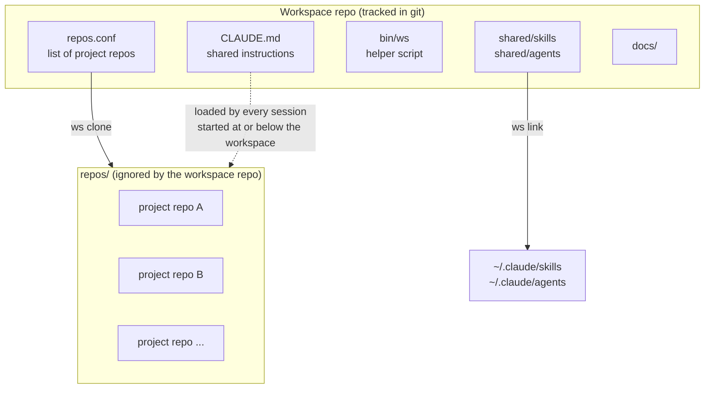

# 01. Design

## Problem

The owner works on dozens of independent git repos, mostly with Claude Code.
The habit so far has been to open one repo and start an agent there. That
breaks down in three ways:

1. A task often needs information from several repos. An agent started in one
   repo does not know the others exist or where they are.
2. Shared agent setup (skills, subagents, conventions) is copied by hand or
   missing, so each repo's agent behaves a little differently.
3. Each computer is set up by hand, so the machines drift apart.

## Goals

- One directory an agent can start in and reach every project.
- An agent started inside a single project still gets the shared context.
- Shared skills and subagents are defined once and available everywhere.
- A new machine reaches a working state by cloning one repo and running one
  command.
- Start with a few repos and add more one at a time, with no restructuring.

## Non-goals

- Pinning exact versions of project repos together. See decision D9.
- Build, CI, release or dependency management across repos.
- Storing secrets or per-machine credentials.
- Replacing a session manager such as Herdr, or a skill registry such as skl.
  The workspace works alongside them.

## Shape of the solution

## Decisions

Each row is one decision. Rejected options are listed so that nobody
re-proposes them without new information.

| ID | Decision | Why | Rejected options |
|---|---|---|---|
| D1 | A meta repo that lists project repos in a manifest | Project repos stay independent, with their own history, remotes and CI. Adding one is a single manifest entry | **Monorepo**: large migration, loses per-repo history and access boundaries. **Git submodules**: every project commit needs a second commit in the parent, and submodules sit on a detached HEAD, which is awkward with dozens of repos |
| D2 | Project repos are cloned under `repos/`, which the workspace repo ignores | A parent directory is what makes the workspace `CLAUDE.md` load in every project session. See 03 | **Sibling directories outside the workspace**: the shared `CLAUDE.md` would no longer be above the projects, so it would not load |
| D3 | The manifest is a git-config file, `repos.conf`, read and written with `git config -f` | Git is the only parser needed and is already required. Identical on macOS and Linux. Fields are named, comments are allowed, and an agent can change it with a command instead of editing text | **YAML**: needs `yq` or a library before bootstrap can run. **JSON**: no comments, needs `jq`. **Plain columns**: positional fields are easy to misread or misalign |
| D4 | Shared skills and agents live in `shared/` and are installed into `~/.claude/` | User-level skills and agents are available from any launch point. A `.claude/skills` at the workspace root would probably not be found from inside a project repo, because skill lookup walks up only to the repo root | **`.claude/skills` at the workspace root**: works only when the session starts at the root. **`--add-dir` on every launch**: easy to forget |
| D5 | The workspace `CLAUDE.md` holds the real instructions, is short, and has no `@` imports. `AGENTS.md` is a pointer to it | `CLAUDE.md` in a parent directory loads in every session below it. An `@` import that resolves outside the launch directory triggers an approval dialog in each project repo | **`AGENTS.md` as the source with `CLAUDE.md` importing it**: the import becomes external when launching inside a project repo. **A long `CLAUDE.md`**: its full text is added to every session in every repo |
| D6 | The repo list inside `CLAUDE.md` is generated from `repos.conf` by `ws index` | Agents see the repo list with no tool call, and the list cannot drift from the manifest | **Hand-maintained list**: drifts. **No list, run `ws list`**: costs a tool call in every session |
| D7 | One bash script, `bin/ws`, compatible with bash 3.2, depending only on git | Runs on a fresh macOS or Linux machine before anything else is installed | **Bun, Node or Python script**: needs a runtime before bootstrap. **An existing multi-repo tool** (mani, vcstool, Google repo): another dependency and its own manifest format, for features not needed yet |
| D8 | `ws link` creates symlinks by default, with a per-machine copy mode | Symlinks mean an edit in `shared/` is live at once. Symlinked skill folders are documented as supported. Copy mode covers a machine where linked agent files are not picked up | **Copy only**: every edit needs a re-link, and edits made in `~/.claude` are lost |
| D9 | The workspace does not record which commit each project repo is on | Keeps daily work free of bookkeeping commits. Each project's own remote is the source of truth for its code | **Pinning commits**: this is what submodules do. Reconsider only if reproducible cross-repo snapshots become necessary |
| D10 | `ws` never deletes a clone and never touches anything in `~/.claude` that it did not create | A helper that manages many repos must not be able to destroy work. Name conflicts are reported and left alone | n/a |

## Consequences to keep in mind

- **No atomic cross-repo change.** A change that spans three repos is three
  commits. If that happens constantly for the same repos, they may belong in
  one repo.
- **Unpushed work is invisible to other machines.** `ws status` exists to make
  that visible. The workspace does not solve it.
- **The manifest can fall behind.** A repo cloned by hand into `repos/` is not
  known to `ws` until it is added with `ws add <name> <url> --no-clone`.
- **A search from the workspace root skips `repos/`.** This follows from D2.
  The rule and the workaround are in the workspace `CLAUDE.md` and in 03.

## Open questions

These are settled by the pilot. Each has a check in `08-pilot-checklist.md`.

| Question | Affects | Check |
|---|---|---|
| Does a `.claude/skills` at the workspace root load from inside a project repo? | D4. If it does, both placements work and D4 is only a preference | P11 |
| Are symlinked agent files in `~/.claude/agents` discovered on macOS and Linux? | D8. If not, use copy mode on that machine | P4 |
| Does Claude Code's own search skip `repos/` from the root, as plain ripgrep does? | Rule 2 in `CLAUDE.md` | P5 |
| Is on-demand loading of a project's `CLAUDE.md` and skills reliable from the root? | How much to rely on root-level sessions for deep single-repo work | P6 |
