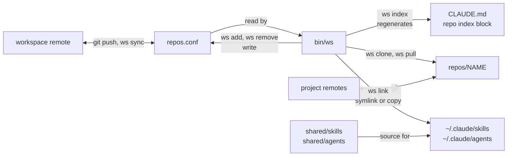
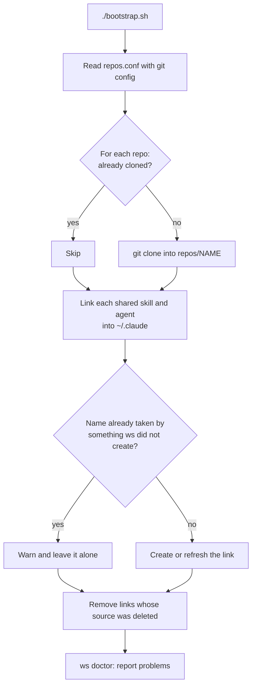

# 02. Architecture

## Files and directories

```
workspace/
├── CLAUDE.md             Shared instructions. Loaded by every session at or below here
├── AGENTS.md             Pointer to CLAUDE.md for tools that look for AGENTS.md
├── README.md             Human quick start
├── LICENSE               MIT
├── repos.conf            Manifest: the list of project repos
├── bootstrap.sh          Wrapper for `ws bootstrap`
├── bin/
│   └── ws                Helper script: clone, link, status, sync, grep, doctor
├── shared/
│   ├── skills/<name>/SKILL.md    One directory per shared skill
│   └── agents/<name>.md          One file per shared subagent
├── docs/                 These design docs
├── tests/
│   └── smoke.sh          Self-contained test of ws
├── .gitignore            Ignores repos/* and per-machine files
└── repos/                Project repos are cloned here
    ├── .gitkeep          The only tracked file in repos/
    └── <name>/           An independent git repo with its own remote
```

## What each part is for

| Part | Read by | Purpose |
|---|---|---|
| `CLAUDE.md` | Claude Code, automatically | Tells an agent it is in a multi-repo workspace, lists the repos, and gives the cross-repo rules |
| `AGENTS.md` | Other coding agents | Sends them to `CLAUDE.md` |
| `repos.conf` | `ws`, and anyone using `git config -f` | Single source of truth for which repos exist, their URLs, tags and descriptions |
| `bin/ws` | The owner and agents | Turns the manifest into clones, installs shared skills and agents, and runs operations across repos |
| `bootstrap.sh` | The owner, on a new machine | Obvious entry point. Runs `ws bootstrap` |
| `shared/skills`, `shared/agents` | Claude Code, through `~/.claude` | Skills and subagents every project should have |
| `docs/` | Agents on demand, and the owner | Reasoning and reference that is too long for `CLAUDE.md` |
| `tests/smoke.sh` | The owner and agents changing `ws` | Proves `ws` works on a given OS without touching real data |
| `repos/` | Everyone | Where the actual project work happens |

## Two kinds of git repo

The workspace contains repos inside a repo. They are not linked by git in any
way. The workspace repo ignores everything under `repos/` except `.gitkeep`.

| | Workspace repo | Project repo |
|---|---|---|
| Location | The workspace root | `repos/<name>/` |
| Tracks | Manifest, instructions, shared skills and agents, docs, scripts | That project's code |
| Remote | One private remote for the workspace | That project's own remote |
| Changes when | A repo is added, a rule or shared skill changes | Project work happens |
| Commit with | `git` at the root | `git -C repos/<name>` or from inside it |

A commit in one never affects the other. `git status` at the workspace root
does not show project changes. Use `ws status` to see everything at once.

## How the parts connect



## What `ws bootstrap` does



Every step checks the current state first, so running bootstrap again changes
nothing when the machine is already set up.

## State outside the workspace

Outside the workspace directory, `ws` writes only inside the Claude Code config directory:

| Location | What | Created by |
|---|---|---|
| `~/.claude/skills/<name>` | Symlink to `shared/skills/<name>`, or a copy in copy mode | `ws link` |
| `~/.claude/agents/<name>.md` | Symlink to `shared/agents/<name>.md`, or a copy in copy mode | `ws link` |
| `~/.claude/.ws-managed` | List of copies made in copy mode, so they can be refreshed and removed safely. Absent in symlink mode | `ws link --copy` |

If `CLAUDE_CONFIG_DIR` is set, that directory is used instead of `~/.claude`.

Per-machine state inside the workspace is limited to `.ws.local`, which
records the link mode and is gitignored.

## Where the workspace directory can live

Any directory works, and the path may differ on each machine. `ws` finds the
workspace from its own location, and links in `~/.claude` are created per
machine with the local path. A path that contains spaces works.

### Recommended: the same path under the home directory on every machine

Use a short path directly under home, such as `~/ws`, on every machine. The
user name, and so the absolute path, can differ freely: `/Users/alex/ws` on a
Mac and `/home/ubuntu/ws` or `/root/ws` on a server are all `~/ws`.

Nothing tracked in git stores an absolute path, so a different user name
needs no change:

| Thing | Why a different home directory does not matter |
|---|---|
| `ws` | Finds the workspace from the script's own location at run time |
| Links in `~/.claude` | Created on each machine by `ws link`, with that machine's path. Not in git |
| `repos.conf` | Paths are relative to the workspace root |
| `CLAUDE.md`, docs, shared skills | Refer to files by relative path |

Keeping the path relative to home identical everywhere has one practical
benefit: a single PATH line works on every machine, so it can live in a
shared dotfiles repo.

```bash
export PATH="$HOME/ws/bin:$PATH"
```

Two things do depend on the absolute path, and both are per machine by
nature: Claude Code's own per-project state under `~/.claude/projects/`, and
any trust or permission choices Claude Code has stored for a directory. They
are simply created again on each machine.

**Rule for anything tracked in the workspace repo:** never write an absolute
home path such as `/Users/<name>/...` or `/home/<name>/...`. Use `~`, `$HOME`,
a path relative to the workspace root, or `$(ws path <name>)`. `ws doctor`
warns when it finds one in `CLAUDE.md`, `AGENTS.md` or `shared/`.

### Locations to avoid

Avoid these locations. `ws doctor` warns about the first three.

| Location | Problem |
|---|---|
| Inside a cloud-synced folder (Dropbox, iCloud Drive, OneDrive, Syncthing) | The sync tool and git both manage the same files. This can corrupt `.git` data and break symlinks. Git is already the sync mechanism |
| Inside another git repo, such as a dotfiles repo | The outer repo sees the workspace as untracked or embedded content |
| Below a directory that has its own `CLAUDE.md` | Claude Code loads every `CLAUDE.md` above the launch directory, so that file is added to every session in every project |
| On an external or network drive that is not always mounted | While it is missing, the links in `~/.claude` point nowhere and shared skills and agents disappear |

After moving or renaming the workspace directory, run `ws link` once and
update the PATH line in the shell profile.

## Safety properties

- `ws` never deletes a project clone. `ws remove` only edits the manifest.
- `ws pull` only fast-forwards, and skips any repo with uncommitted changes.
- `ws link` refuses to replace a skill or agent it did not install.
- `ws clone` leaves a non-empty directory that is not a git repo untouched.
- The whole script is parsed before it runs, so `ws sync` can update the
  script itself and then restart with the new version.
