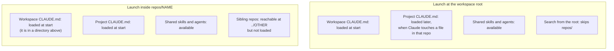

# 03. How context, skills and agents load

The workspace design depends on where Claude Code looks for instructions,
skills and subagents. Those rules differ from each other, and they depend on
the directory the session was started in. This doc records the rules the
design relies on. Labels (Documented, Tested, Inferred) are defined in
`docs/README.md`. Claude Code changes often: recheck against the sources at
the end when behavior differs.

## The two launch points



| Item | Launch at workspace root | Launch inside `repos/<name>` | Basis |
|---|---|---|---|
| Workspace `CLAUDE.md` | Loaded at start | Loaded at start | Documented |
| Project `CLAUDE.md` | Loaded on demand, when Claude reads, writes or edits a file in that repo | Loaded at start | Documented |
| Shared skills in `~/.claude/skills` | Available | Available | Documented |
| Shared agents in `~/.claude/agents` | Available | Available | Documented for regular files. Symlinked files: Inferred, check P4 |
| A project's own `.claude/skills` | Discovered on demand. Users have reported this as unreliable | Loaded | Documented, with a reported issue |
| A `.claude/skills` at the workspace root | Loaded | Probably not loaded | Inferred, check P11 |
| A project's `AGENTS.md`, when it has no `CLAUDE.md` | Not loaded by default | Not loaded by default | Documented. See G1 |
| Auto memory | One store per git repository | One store per git repository | Documented |

Pick the launch point by the task. Start at the root for work that spans
repos. Start inside the project for deep work on one repo, where that
project's own instructions and skills should be fully loaded from the start.

## Rules the design relies on

### R1. `CLAUDE.md` is collected upward from the launch directory (Documented)

Claude Code loads `CLAUDE.md` and `CLAUDE.local.md` from the launch directory
and from every directory above it. The files are concatenated, ordered from
the filesystem root down to the launch directory, so the project's file is
read after the workspace's file. `CLAUDE.md` files in subdirectories load only
when Claude reads, writes or edits a file in that subdirectory.

This is why project repos live inside the workspace directory (decision D2):
it puts the workspace `CLAUDE.md` above every project.

### R2. Project skills are looked up only as far as the repository root (Documented, consequence Inferred)

Project skills load from `.claude/skills/` in the launch directory and in each
parent directory up to the repository root. A project repo is its own git
repository, so the lookup should stop at `repos/<name>` and never reach the
workspace root. That is why shared skills are installed at user level
(decision D4) instead of in a `.claude/skills` at the workspace root.

The docs state the lookup rule. That it stops at the nested repo's root has
not been confirmed here. Pilot check P11 settles it.

### R3. User-level skills and agents apply everywhere (Documented)

Skills in `~/.claude/skills/<name>/SKILL.md` and subagents in
`~/.claude/agents/<name>.md` are available in every session for that user. A
skill entry may be a symlink to a directory elsewhere on disk. The docs do not
say the same for agent files, so `ws link --copy` exists as a fallback.

When a project defines an agent with the same name as a shared one, the
project's agent is used. Do not rely on name precedence for skills. Give
shared and project skills different names.

### R4. `--add-dir` grants file access, plus skills, but not instructions (Documented)

`claude --add-dir <path>` lets the session read another directory. Skills in
that directory's `.claude/skills/` load. Its `CLAUDE.md` does not, unless the
environment variable `CLAUDE_CODE_ADDITIONAL_DIRECTORIES_CLAUDE_MD=1` is set.

Useful from inside one project: `claude --add-dir ../other-repo`.

### R5. Subagents start with their own context

A subagent does not see the main conversation. The shared `repo-scout` agent
is written to find the workspace root and the target repo by itself for that
reason.

## Gotchas

### G1. A project that relies only on `AGENTS.md` loses it (Documented)

By default Claude Code reads `AGENTS.md` only when there is no `CLAUDE.md`,
`.claude/CLAUDE.md` or `CLAUDE.local.md` in the launch directory **or any
directory above it**. The workspace `CLAUDE.md` is above every project, so a
project that has an `AGENTS.md` and no `CLAUDE.md` stops getting its
`AGENTS.md` once it is cloned into the workspace.

`ws doctor` reports every repo in that state. Fix it in one of two ways:

1. **Per machine, covers all repos.** Tell Claude Code to load both kinds of
   file. Run `/config` and set **Project instructions** to
   `claude-md-and-agents-md`, or add this to `~/.claude/settings.json`. The
   setting is ignored in project-level settings files.

   ```json
   {
     "pluginConfigs": {
       "cc-plugin-agents-md@builtin": {
         "options": { "instructionFiles": "claude-md-and-agents-md" }
       }
     }
   }
   ```

2. **Per repo, travels with the repo.** Add a `CLAUDE.md` to that project
   containing the single line `@AGENTS.md`. That import stays inside the
   project, so it is not an external import.

Reading `AGENTS.md` directly needs Claude Code v2.1.277 or later. Before
v2.1.285 the plugin ID in the settings file was `agents-md@builtin`.

### G2. A search from the workspace root skips `repos/` (Tested)

`repos/` is gitignored by the workspace repo, and ripgrep honors `.gitignore`.
Tested with ripgrep 15.1.0 in a workspace laid out like this one:

| Command, run at the workspace root | Finds text inside a project repo |
|---|---|
| `rg PATTERN` | No |
| `rg PATTERN repos` | No |
| `rg PATTERN repos/<name>` | Yes |
| `rg PATTERN`, run from inside `repos/<name>` | Yes |

Claude Code's search tools are built on ripgrep, so expect the same. Not yet
confirmed with Claude Code itself: pilot check P5.

Workarounds, both stated in the workspace `CLAUDE.md`:

- Give the search an explicit path: `repos/<name>`.
- Run `ws grep <pattern>`, which runs `git grep` inside every project repo.

### G3. An `@` import in the workspace `CLAUDE.md` triggers an approval dialog (Documented)

An import in a project-level instruction file is "external" when it resolves
outside the launch directory. For a session started inside `repos/<name>`,
anything the workspace `CLAUDE.md` imports is outside. Claude Code shows a
one-time approval dialog per project, and a declined dialog disables the
imports for good. With dozens of repos that is dozens of dialogs.

So the workspace `CLAUDE.md` contains no imports (decision D5). It names other
files by plain path in backticks, and the agent reads them when needed.
`ws doctor` warns if an import appears.

### G4. Everything in the workspace `CLAUDE.md` costs context in every session

It is loaded in full at the start of every session at or below the workspace.
Keep it to the map, the repo index and the rules. `ws doctor` warns above 150
lines. Put detail in `docs/`.

### G5. Auto memory is per repository and per machine (Documented)

Claude Code's own notes are stored in `~/.claude/projects/<project>/memory/`,
keyed by git repository, and are not shared between machines. What an agent
learned on one computer is not known on another. Anything worth keeping
belongs in a `CLAUDE.md`, in `docs/`, or in a shared skill.

A session started at the workspace root uses the workspace repo's memory
store, not the stores of the project repos.

### G6. Instructions are context, not enforcement (Documented)

Claude treats `CLAUDE.md` as guidance. A rule that must never be broken, such
as "never push to main", needs a hook or a permission rule, not a sentence in
`CLAUDE.md`.

## Sources

Checked on 2026-11-15.

- Claude Code memory and instruction files: https://code.claude.com/docs/en/memory
- Claude Code skills: https://code.claude.com/docs/en/skills
- Claude Code subagents: https://code.claude.com/docs/en/sub-agents
- Report that nested skill discovery does not work as documented: https://claudeissues.com/issue/40640-docs-automatic-discovery-from-nested-directories-for-skills-does-not-work-as-doc
- Discussion of skill discovery across nested git repos: https://claudeissues.com/issue/62237-docs-skill-discovery-across-nested-git-repos-via-parent-walk-and-additionaldirec
