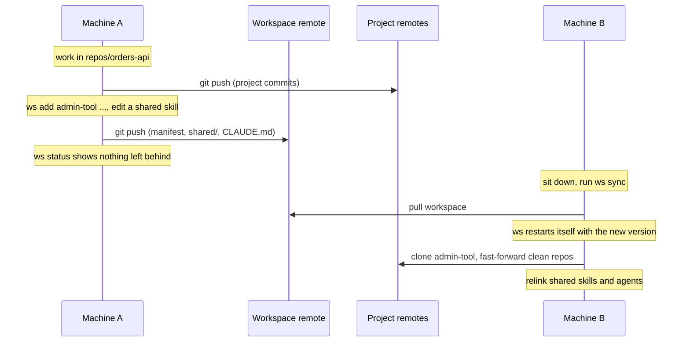

# 06. Working on more than one machine

## What carries what

| Thing | Carried by | Arrives on another machine through |
|---|---|---|
| The list of repos | Workspace repo (`repos.conf`) | `ws sync` |
| Shared instructions | Workspace repo (`CLAUDE.md`) | `ws sync` |
| Shared skills and agents | Workspace repo (`shared/`) | `ws sync`, which also relinks |
| Design docs, `ws` itself | Workspace repo | `ws sync` |
| Project code | Each project's own remote | `ws sync` or `ws pull`, for clean repos |
| A newly added project | Manifest entry plus its remote | `ws sync` clones it |

## What does not travel

| Thing | Why | What to do |
|---|---|---|
| Uncommitted or unpushed work | Git only moves pushed commits | `ws status` before leaving. Commit and push |
| Claude Code auto memory | Stored per machine in `~/.claude/projects/` | Move lasting knowledge into `CLAUDE.md`, `docs/` or a skill |
| Claude Code sign-in and `~/.claude/settings.json` | Per-machine, outside the workspace | Set up once per machine |
| Secrets and `.env` files | Deliberately gitignored | Use a password manager or per-machine setup |
| The link mode (`.ws.local`) | Per-machine choice | `ws link --copy` on machines that need it |
| Running agent sessions | They are processes on one machine | See "One host, many screens" below |
| Installed tools: git, Claude Code, runtimes | Outside the scope of the workspace | A dotfiles repo or a setup script |

## The cycle

## What `ws sync` does, in order

1. Pulls the workspace repo, if it is clean and has an upstream.
2. Restarts itself, so a newer `ws` and a newer manifest take effect.
3. Clones every repo in the manifest that is missing.
4. Fast-forwards every project repo that is clean and has an upstream.
5. Links shared skills and agents, and prunes ones that were deleted.
6. Prints `ws status`.

It never merges, rebases, stashes or discards anything. A repo that is dirty
or has diverged is reported and left for you.

## Conflicts in the workspace repo

Two machines can both change `repos.conf` or `CLAUDE.md` before syncing.

- `repos.conf`: each `ws add` appends a section, so conflicts are simple.
  Keep both sections.
- `CLAUDE.md` repo index: do not resolve by hand. Take either side, then run
  `ws index` to regenerate the block from the merged manifest.

## One host, many screens

Syncing files is one way to use several computers. The other is to keep the
workspace and the running agents on one always-on machine and attach to it
from the others, over SSH or with a session manager such as Herdr.

| | Sync between machines | One host, attach remotely |
|---|---|---|
| Work in progress | Must be pushed to move | Already there |
| Running agents | Stay on the machine that started them | Keep running while you switch screens |
| Works offline | Yes | No |
| Needs | A remote for every repo | A reachable always-on machine |

The two combine well: the workspace repo keeps every machine identically set
up, and the host model keeps long-running sessions alive. See `07-herdr.md`.
