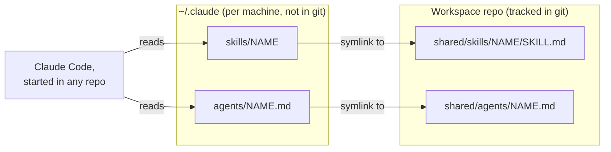

# 10. Shared skills and agents: create, change, delete

This doc covers how a skill or subagent in `shared/` reaches Claude Code, what
each kind of change requires, and what to check when one does not show up.

## The one rule

**Edit files in `shared/`. Never edit anything under `~/.claude/skills` or
`~/.claude/agents` by hand.**

The entries in `~/.claude` are links that point back into `shared/`. The file
in `shared/` is the only real copy. It is tracked by git and it is what
reaches other machines.

## How it works



Claude Code looks in `~/.claude/skills` and `~/.claude/agents` for skills and
subagents that apply in every project. `ws link` puts one symlink there for
each shared skill directory and each shared agent file. Reading the link
returns the content of the file in `shared/`.

Links hold an absolute path, which differs between machines. They are created
on each machine by `ws link`, which `bootstrap.sh` and `ws sync` both run.
Links are never committed.

## What each operation requires

| Operation | Do this in `shared/` | Run `ws link`? | Effect in `~/.claude` |
|---|---|---|---|
| Create | Add `skills/<name>/SKILL.md` or `agents/<name>.md` | Yes | A new link appears |
| Read | Nothing | No | Claude Code reads through the link |
| Update | Edit the file | No | None. The link already points at the edited file |
| Delete | Remove the directory or file | Yes | The link dangles until `ws link` removes it |
| Rename | Rename the directory or file | Yes | Old link removed, new link created |

After any of these, commit and push the workspace repo. Other machines pick
the change up with `ws sync`, which pulls and then links.

Also keep in mind:

- A skill's `name` in its frontmatter should match its directory name. An
  agent's `name` should match its file name without `.md`.
- Claude Code may need a restart to notice a newly created skill or agent. A
  session that is already running may keep the old text of an edited one.
- In copy mode (see below) the Update row changes to "Yes, run `ws link`".

## What not to do

| Mistake | What goes wrong | Do this instead |
|---|---|---|
| Create a skill directly in `~/.claude/skills` | It exists on one machine only and is not in git | Create it in `shared/skills`, then `ws link` |
| Edit a file through its path in `~/.claude` | In symlink mode it happens to edit the real file, but it hides which repo changed. In copy mode the edit is overwritten by the next `ws link` | Edit the path under `shared/` |
| Delete a link in `~/.claude` to remove a skill | The source still exists, so the next `ws link` recreates it | Delete it from `shared/`, then `ws link` |
| Put a one-project skill in `shared/` | Every project gets it, and its description costs context everywhere | Put it in that project's `.claude/skills/` |
| Commit a link | Links hold a machine-specific path | Nothing to do. `~/.claude` is outside the repo |

## Shared or project-level

| Put it in | When |
|---|---|
| `shared/skills`, `shared/agents` | It is useful in most projects, or it is about working across projects |
| `repos/<name>/.claude/skills`, `repos/<name>/.claude/agents` | It only makes sense for that project. It is then versioned with that project |

Give a shared item and a project item different names. For agents, a
project-level agent overrides a shared one with the same name. For skills, do
not rely on which one wins.

## Name conflicts with things you already have

`ws link` never replaces something it did not create. If `~/.claude/skills`
already has an entry with the same name as a shared skill, `ws link` warns,
skips that one item, links the rest, and exits with status 1. Rename one of
the two, or remove your own copy, then run `ws link` again.

Skills and agents you installed some other way stay exactly as they are.
`ws link` works item by item and does not take over the whole directory.

## Copy mode

On a machine where a linked agent or skill is not picked up, switch that
machine to copies:

```bash
ws link --copy       # this machine now gets real copies. The choice is remembered
ws link --symlink    # switch back
```

In copy mode:

- `ws link` must be run after every edit in `shared/`. It refreshes all copies.
- The copies are listed in `~/.claude/.ws-managed`, so `ws link` knows which
  files it may overwrite or remove.
- Never edit a copy. The next `ws link` replaces it.

The mode is stored in `.ws.local` inside the workspace, which is gitignored,
so each machine keeps its own choice.

## Checking and troubleshooting

```bash
ws doctor                      # reports every shared item that is not installed
ls -l ~/.claude/skills         # links show as: name -> /path/to/workspace/shared/skills/name
ls -l ~/.claude/agents
```

| Symptom | Likely cause | Fix |
|---|---|---|
| A new skill or agent is missing in Claude Code | `ws link` was not run, or Claude Code was not restarted | `ws link`, then restart Claude Code |
| A skill directory is ignored by `ws link` | It has no `SKILL.md` directly inside it | Add `SKILL.md` |
| An agent is installed but not listed by `/agents` | Symlinked agent files may not be discovered on this OS | `ws link --copy`, restart, and record it in `08-pilot-checklist.md` |
| A deleted skill is still offered | The link was pruned but the session is old | Restart Claude Code |
| `ws link` warns that something "already exists" | A name conflict with an item you installed yourself | See "Name conflicts" above |
| All shared skills vanished | The workspace directory was moved or its drive is not mounted | Run `ws link` from the new location, or mount the drive |
| A change is missing on another machine | The workspace repo was not pushed, or not synced there | Push here, then `ws sync` there |

## Removing everything

`ws unlink` removes every link and copy that `ws link` created and leaves
everything else in `~/.claude` alone. The files in `shared/` are not touched.
